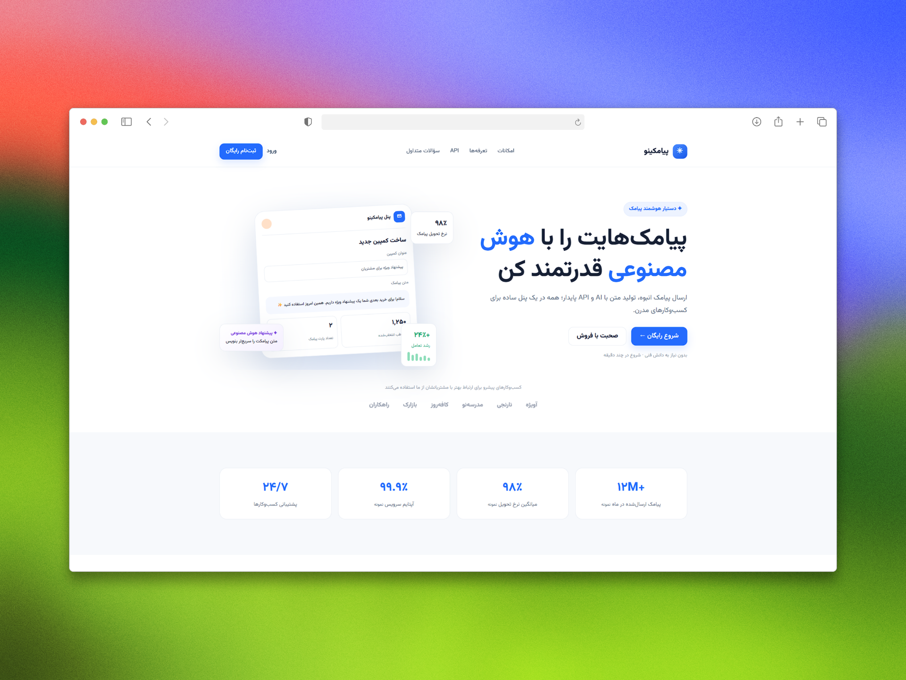

```markdown
# پیامکینو | Payamakino

پیامکینو یک پلتفرم بازاریابی پیامکی با ابزارهای مدیریت کمپین، مخاطبین و گزارش‌هاست. هدف پروژه، ساده‌کردن ارتباط کسب‌وکارها و سازمان‌ها با مخاطبانشان از طریق پیامک است.

این پروژه شامل رابط کاربری صفحات اصلی، احراز هویت و داشبورد پیامکینو است و به‌صورت پروتوتایپ فرانت‌اند پیاده‌سازی شده است.

## مخاطبان هدف

- صاحبان کسب‌وکارهای کوچک
- مدیران بازاریابی
- توسعه‌دهندگان
- مدیران سازمان‌ها و مدارس

## بخش‌های پروژه

### صفحه‌ی اصلی

- نوار ناوبری ثابت
- بخش معرفی محصول و دکمه‌های اقدام
- نمایش آمار و مشتریان
- دمو تعاملی دستیار هوشمند
- معرفی امکانات و مراحل استفاده
- نمایش نمونه‌ی محصول
- معرفی کاربردها
- نمونه‌کدهای API
- پلن‌های قیمت‌گذاری
- نظرات کاربران
- پرسش‌های متداول
- دعوت نهایی به ثبت‌نام و فوتر

### صفحه‌ی ورود و ثبت‌نام

- طراحی واکنش‌گرا
- فرم ورود و ثبت‌نام
- جابه‌جایی بین حالت ورود و ثبت‌نام
- بخش معرفی محصول

### داشبورد

- نمای کلی آمار ارسال پیامک، نرخ تحویل، تعداد مخاطبین و اعتبار
- نمودار عملکرد ارسال پیامک
- نمودار وضعیت تحویل
- فرم ارسال سریع پیامک
- پیشنهاد متن پیامک با دستیار هوشمند
- نمایش فعالیت‌های اخیر
- فهرست کمپین‌های اخیر
- مدیریت کمپین‌ها و مخاطبین
- گزارش‌های ارسال
- قالب‌های پیامک
- دستیار هوشمند
- نمونه‌کد API برای cURL، Python، PHP و Node.js
- مدیریت خطوط ارسال
- نمایش اعتبار و تراکنش‌ها
- تنظیمات حساب و اعلان‌ها
- منوی واکنش‌گرا برای موبایل

## فناوری‌ها

- HTML
- CSS
- JavaScript
- فونت Vazirmatn برای رابط فارسی
- فونت Inter برای متن انگلیسی و کدها

## طراحی و تجربه‌ی کاربری

- طراحی راست‌چین و پشتیبانی از زبان فارسی
- سازگار با نمایشگرهای دسکتاپ و موبایل
- استفاده از رنگ آبی به‌عنوان رنگ اصلی برند
- پس‌زمینه‌ی روشن، فاصله‌گذاری مناسب و مرزبندی ظریف
- نمایش اعداد فارسی در رابط کاربری
- نمایش کدها و مسیرهای API با جهت چپ‌به‌راست

## اجرا

برای اجرای پروژه، مخزن را دریافت کنید و فایل HTML موردنظر را در مرورگر باز کنید:

```bash
git clone <repository-url>
cd <project-folder>
```

همچنین می‌توانید فایل‌ها را با یک سرور محلی، مانند افزونه‌ی Live Server در VS Code، اجرا کنید.

## ساختار پیشنهادی پروژه

```text
payamakino/
├── index.html
├── auth.html
├── dashboard.html
├── assets/
│   ├── images/
│   └── icons/
├── styles/
│   └── main.css
├── scripts/
│   └── main.js
├── LICENSE
└── README.md
```



## وضعیت پروژه

این پروژه در حال حاضر یک پروتوتایپ فرانت‌اند است. اجزای رابط کاربری و برخی تعامل‌ها با JavaScript پیاده‌سازی شده‌اند؛ اما داده‌ها و عملکردها نمایشی هستند و به سرویس واقعی متصل نیستند.

برای استفاده‌ی عملی، بخش‌های زیر باید به بک‌اند متصل یا پیاده‌سازی شوند:

- ثبت‌نام، ورود و مدیریت نشست کاربران
- ذخیره‌سازی و مدیریت مخاطبین
- ساخت، زمان‌بندی و ارسال کمپین‌های واقعی
- اتصال به سرویس ارسال پیامک
- دریافت و نمایش گزارش‌های واقعی
- اتصال دستیار هوشمند به سرویس تولید متن
- اتصال به API پیامکینو
- پرداخت آنلاین و افزایش اعتبار
- اعتبارسنجی داده‌ها و مدیریت خطاها

## مشارکت

برای گزارش مشکل یا پیشنهاد قابلیت جدید، یک Issue ثبت کنید. برای مشارکت در توسعه‌ی پروژه نیز می‌توانید Pull Request ارسال کنید.

## مجوز

مجوز استفاده و بازنشر پروژه را در فایل `LICENSE` مشخص کنید.
